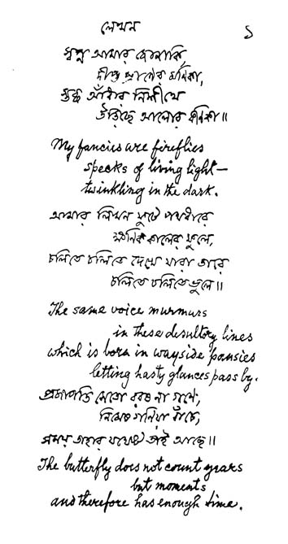

# Orus-OCR-1.0-alpha

Small, CPU-only OCR for **Bangla, English and mixed Bangla + English** pages, handwritten or printed.

For every page Orus-OCR returns the **text with its layout** (line breaks, indentation, blank lines), the **language** (`bn`, `en` or `bn+en`), whether the page is **handwritten**, and every line with its box and a confidence score. Text inside photos and charts is ignored. The recognizer has 1.76M parameters and runs on ONNX Runtime: about 0.3 s for a 22-line handwritten page on a 6-core desktop CPU, with no GPU.

**Model weights:** [huggingface.co/orus-research/Orus-OCR-V1.0](https://huggingface.co/orus-research/Orus-OCR-V1.0) (downloaded automatically on first use).

| | CER % | WER % |
|---|---|---|
| Handwritten Bangla (4 test sets) | 7.1 | 22.6 |
| Handwritten English (IAM, GNHK, IMGUR5K) | 9.5 | 25.6 |
| Printed Bangla (4 test sets) | 4.1 | 10.9 |
| Printed English (fonts, receipts, forms) | 3.0 | 11.6 |
| Receipts / prescriptions / digits | 3.5 / 2.7 / 10.6 | 9.1 / 5.5 / 17.0 |

Line-level means over 300 test lines per set. Full results, including where the model is weak, are in [docs/BENCHMARKS.md](docs/BENCHMARKS.md).

> **Alpha release, non-commercial use.** The code is MIT (Non-Commercial); the weights are under the Orus-OCR Model Licence (non-commercial, plus the Indra OCR Open RAIL-M terms). See [Licence](#licence).

## Install

Python 3.10 or newer.

```bash
git clone https://github.com/Orus-Research/Orus-OCR-V1.0.git
cd Orus-OCR-V1.0
pip install -r requirements.txt
```

The first run downloads the Orus weights (about 12 MB) from Hugging Face and the Indra OCR line detector from [datalab-to/indra-ocr](https://huggingface.co/datalab-to/indra-ocr). Both are cached by `huggingface_hub`, so later runs work offline.

## Quick start

```bash
python run.py page.jpg              # language, handwritten Yes/No, and the text
python run.py page.jpg --json       # + every line: box, text, confidence, language; timings
python run.py page.jpg --fast       # about 2x faster, +1.5 CER on handwriting
python run.py *.jpg --weights DIR   # local copy of the weights instead of the download
```

```python
import sys
sys.path.insert(0, "orus")
from ocr import OCR

ocr = OCR()                          # OCR(weights="path/to/weights") to use a local copy
result = ocr("page.jpg")             # a file path or a BGR / grey numpy image

print(result["language"], result["handwritten"])
print(result["text"])

for line in result["lines"]:         # bbox [x0, y0, x1, y1], text, conf, lang
    if line["conf"] < 0.8:
        print("check this line:", line["text"])
```

## Example

[`examples/example.py`](examples/example.py) runs the pipeline on a page in Rabindranath Tagore's own hand: his poem *Lekhan*, Bangla verses with his English translations, a public-domain image from [Wikimedia Commons](https://commons.wikimedia.org/wiki/File:Tagore_handwriting_Bengali.jpg).

```bash
python examples/example.py
```



Output (CPU, 314 ms):

```
Language:    bn+en
Handwritten: Yes
   লেখন
 প্রশ্ন আমার জাহানি
   দীপ্ত প্রাণের মনিকা
 শুষ্ক আঁধার নিলাকে
   উন্তিচ্ছে আলোর ধরা ।
 My fancies are fireflies
  speaks of living light-
  Twinkling in the dark.
 আমার লিখন ফুটে পর্থধারে
    ক্ষণিক কালের ফুলে ,
 চলতে বলিতে দেখে যারা তারে
    চলতে বলিতে তুলে ।
 The same voice murmurs
    in These desultory lines
which is born in wayside pansies
   letting hasty glances pass by.
প্রজাপতি মেতে বরং না গলে ,
   নিমেষ গিয়া ধাঁচে ।
সময় তাহার যে তাই আছে ।
The butterfly does not count years
     butmoments
 and therefore has enough time .
```

The language, the handwritten flag and the layout (indented lines, line order) are right. The English lines are close (errors: *speaks* for "specks", *These*, *butmoments*). The Bangla lines are harder: Tagore's calligraphic hand is unlike anything in the training data, and several words are misread, which is typical for unseen Bangla handwriting (see [the held-out set](docs/BENCHMARKS.md#per-test-set)). The full output with per-line confidence is in [`examples/example_output.txt`](examples/example_output.txt).

## How it works

```
page ─ deskew ─ line detector ─ drop lines on pictures ─ line recognizer ─ decoding ─ layout ─ text
                (Indra OCR det)   (picture-region net)    (CNN + BiLSTM,     (char LM,     (rows, indents,
                                                           CTC, 48 px)        lexicon,      language,
                                                                              re-read)      handwritten flag)
```

- **Recognizer:** Indra OCR-style convolutional CTC line recognizer, warm-started from Indra OCR 1.1, with an added 2-layer BiLSTM, reading 48 px lines with context above and below. One model for both scripts and mixed lines; 211 characters.
- **Decoding:** greedy CTC; a character 5-gram LM rescores unsure lines; a 246k-word Bangla + English lexicon corrects words with a CTC prefix beam over the lexicon (a clearly written rare word or name is kept); lines with confidence below 0.8 are read again slightly squeezed and stretched and the most confident reading wins.
- **Layout:** detector fragments of one slanted line are chained; rows are ordered top to bottom with indentation and paragraph gaps.
- **Extras:** a 38k-parameter net finds photos and charts so their text is skipped; a 98k-parameter tile classifier says whether the page is handwritten.

## Repository

| Path | What |
|---|---|
| `run.py` | command-line tool |
| `orus/ocr.py` | the pipeline: `OCR`, `Recognizer`, `Detector`, layout, ONNX export |
| `orus/ocr_model.py`, `orus/vocab.py` | recognizer network, vocabulary |
| `orus/ocr_words.py`, `orus/ocr_lm.py` | word lexicon correction, character LM (decode and build) |
| `orus/ocr_data.py`, `orus/ocr_synth.py`, `orus/render_printed.py` | dataset parsers, line stores, synthetic line generator |
| `orus/ocr_train.py`, `orus/ocr_finetune.py`, `orus/ocr_aug.py` | training, fine-tuning on your own data, extra augmentation |
| `orus/ocr_bench.py` | line-level benchmark |
| `train.sh` | the full training recipe, stage by stage |
| `examples/` | example page, script and output |
| `docs/` | [benchmarks](docs/BENCHMARKS.md), [datasets](docs/DATASETS.md), [training, hardware and compute](docs/TRAINING.md) |

## Training

The released recognizer took about 13.3 GPU hours on a single RTX 3060 (12 GB), peaking at 8.1 GB of GPU memory, through a chain of warm starts from Indra OCR's weights. It was trained on 365k real lines and words from 18 public datasets and 473k synthetic lines. [docs/TRAINING.md](docs/TRAINING.md) has the stages, hyperparameters, hardware and resource use; [docs/DATASETS.md](docs/DATASETS.md) lists every dataset with its link and licence. To retrain:

```bash
pip install -r requirements-train.txt
./train.sh data32 synth32 lm lex A B1 B3 C D data48 S1 main ext export bench
```

## Limitations

- Alpha quality. Handwritten WER is 18–34% on English and 10–40% on Bangla test sets; check lines with confidence below 0.8.
- Bangla handwriting from writers unlike the training data is much harder (11% CER on a held-out set).
- Scene text (signs, product labels) and faint scanned forms are weak.
- Dense, slanted Bangla handwriting can make the line detector merge lines.
- Single-column reading order. No tables, no maths beyond plain arithmetic.
- Characters outside Latin and the Bengali block (accented Latin, other scripts) are not recognised.

## Licence

- **Code** (this repository): [MIT License (Non-Commercial)](LICENSE).
- **Model weights** (Hugging Face): the [Orus-OCR Model Licence](https://huggingface.co/orus-research/Orus-OCR-V1.0/blob/main/LICENSE): non-commercial use only, because several training datasets are licensed for non-commercial use; and, because the recognizer is derived from Indra OCR, the Indra OCR AI Pubs Open RAIL-M licence (modified) and its use restrictions also apply.
- **Indra OCR** line detector, downloaded at run time from [datalab-to/indra-ocr](https://huggingface.co/datalab-to/indra-ocr): its own licence. The `indra-ocr` Python package is Apache 2.0.
- **Training data** is not distributed; each dataset keeps its own licence ([docs/DATASETS.md](docs/DATASETS.md)).
- **Example image:** Rabindranath Tagore, *Lekhan*, public domain, via Wikimedia Commons.

## Acknowledgements

Orus-OCR builds on [Indra OCR](https://huggingface.co/datalab-to/indra-ocr) by Datalab (line detector, recognizer architecture and initial weights, preprocessing and LM beam search from the `indra-ocr` package), and on the datasets listed in [docs/DATASETS.md](docs/DATASETS.md); thanks to their authors. The previous version, Orus-OCR-0.1-alpha, is at [github.com/MahirHamiAbrar/Orus-OCR-V0](https://github.com/MahirHamiAbrar/Orus-OCR-V0).

## Citation

```bibtex
@software{orus_ocr_2026,
  title  = {Orus-OCR-1.0-alpha: CPU OCR for Bangla and English handwriting and print},
  author = {{Orus Research}},
  year   = {2026},
  url    = {https://github.com/Orus-Research/Orus-OCR-V1.0}
}
```
